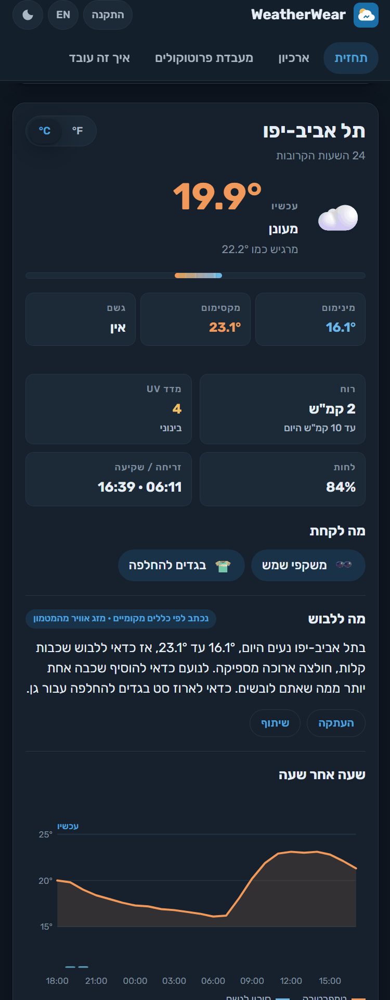

<div dir="rtl">

# WeatherWear

**תחזית מזג אוויר שאומרת לכל בן משפחה מה ללבוש, ומגיעה אליכם דרך מחסנית רשת שנכתבה מאפס:
DHCP,‏ DNS,‏ TCP ופרוטוקול אמין שנבנה מעל UDP.**

**לנסות עכשיו: [weatherwear-s7pl.onrender.com](https://weatherwear-s7pl.onrender.com/#lang=he)**
<sub>(אחסון חינמי: הכניסה הראשונה אחרי זמן שקט עשויה לקחת עד דקה עד שהשרת מתעורר)</sub>

[English](README.md) · [איך זה עובד, לעומק (אנגלית)](docs/architecture.md) · [אבטחה (אנגלית)](SECURITY.md)

<p align="center">
  
</p>

## מה זה עושה

מקלידים עיר (בעברית או באנגלית), מתארים מי יוצא מהבית (תינוק, ילד שתמיד קר לו, מבוגר) ומקבלים:

* **24 השעות הקרובות** בגרף, את השבוע, רוח, UV, לחות ו"מרגיש כמו";
* **המלצה שנכתבת לכל אחד**: תינוק מקבל משפט אחר ממבוגר, והיא אומרת באיזו שעה יתחיל הגשם,
  לא רק ש"אולי ירד גשם";
* **מה לקחת**: רשימה קצרה באייקונים (מטרייה, קרם הגנה, בגדים להחלפה...);
* חלונית **מתחת למכסה המנוע** שמראה איך התשובה עברה ברשת: באיזה פרוטוקול, כמה דאטגרמות,
  כמה שודרו מחדש, הגיעו פעמיים או נכשלו בבדיקת השלמות.

האתר עובד בעברית ובאנגלית (כולל פריסה מלאה מימין לשמאל), במצב בהיר וכהה, בטלפון, ניתן להתקנה
כאפליקציה ונפתח גם בלי חיבור על התחזית האחרונה. אפשר לשתף תחזית כקישור.

## מעבדת הפרוטוקולים

הלשונית **מעבדת פרוטוקולים** שולחת קובץ דרך רשת מדומה, עם אובדן מנות, השהיה, גודל קובץ
ומאגר קבלה שאתם בוחרים, ומציירת את חלון הגודש תוך כדי: התחלה איטית, timeout שמפיל את החלון,
fast retransmit שחוצה אותו, ובקרת זרימה שמגבילה אותו. רץ שם **השולח והמקבל האמיתיים של RUDP**
מהפרויקט, בלי שינוי, על שעון וירטואלי, לצד מודל של TCP Reno על אותו קו בדיוק, כך שאפשר להשוות
ביניהם מנה מול מנה. לכל ניסוי יש קישור, למשל
[15% אובדן](https://weatherwear-s7pl.onrender.com/#lab?loss=15&delay=80&size=64&buffer=8&seed=2).

## איך זה בנוי

האתר הוא **עוד מחשב ברשת המדומה**. דפדפן לא יודע לדבר RUDP, ופורט UDP שעונה לבקשה קטנה
בתשובה גדולה אסור שיהיה חשוף לאינטרנט, ולכן רק HTTPS פתוח החוצה. מאחוריו, השער מצטרף לרשת
כמו כל לקוח: מקבל כתובת ב-DHCP, מתרגם שם ב-DNS, ושולח את הבקשה לשרת היישום ב-TCP או ב-RUDP.

* **RUDP שנכתב מאפס**: CRC32 על הכותרת והמידע, חלון הזזה, התחלה איטית והימנעות מגודש,
  fast retransmit אחרי שלושה ACK כפולים, ובקרת זרימה דרך חלון קבלה מוכרז.
* **DHCP שמנהל את המאגר ביושר**: הצעה שומרת כתובת ולא מחכירה אותה, וחוזרת למאגר אם לא נתבעה;
  שרת גיבוי עונה באיחור מהמאגר שלו.
* **עמידות כשספק המידע חוסם**: מפסק לכל נקודת קצה אחרי HTTP 429, ספק שני (MET Norway) שהנתונים
  השונים שלו מטופלים ביושר, ותחזית אחרונה עם הודעה כששניהם לא זמינים.
* **פרטיות כברירת מחדל**: תיאור המשפחה נשמר במכשיר שלכם ולא בשרת; מיקום משותף מעוגל, נשמר תחת
  שם מגובב ולא מופיע בארכיון הציבורי ולא בקישור.

## אבטחה

* **Fuzzing** לכל מפענח רשת (Hypothesis) מצא שלושה באגים אמיתיים, שכל אחד מהם הוא היום בדיקת רגרסיה.
* **ב-CI בכל push**: ‏Bandit,‏ pip-audit,‏ CodeQL ו-gitleaks על כל ההיסטוריה, ו-Dependabot.
* **הקשחה**: אימות קלט, הגבלת קצב לכל מבקר, הגבלת גודל בקשה, תקרות לחוטים ולחיבורים, הגנה מפני
  path traversal, ו-CSP ו-HSTS.
* מודל איומים עם 25 איומים והמענה לכל אחד: [SECURITY.md](SECURITY.md).

## איכות

**547 בדיקות אוטומטיות** עם sockets מדומים, כך ששום דבר לא נוגע ברשת.

## להריץ בעצמכם

</div>

```bash
pip install -r requirements.txt
python -m src.web.serve          # http://127.0.0.1:8000
python run.py                    # desktop client
```

<div dir="rtl">

## מפתח

**Matanel Levavi** · [GitHub](https://github.com/Matanelevavi)

</div>
