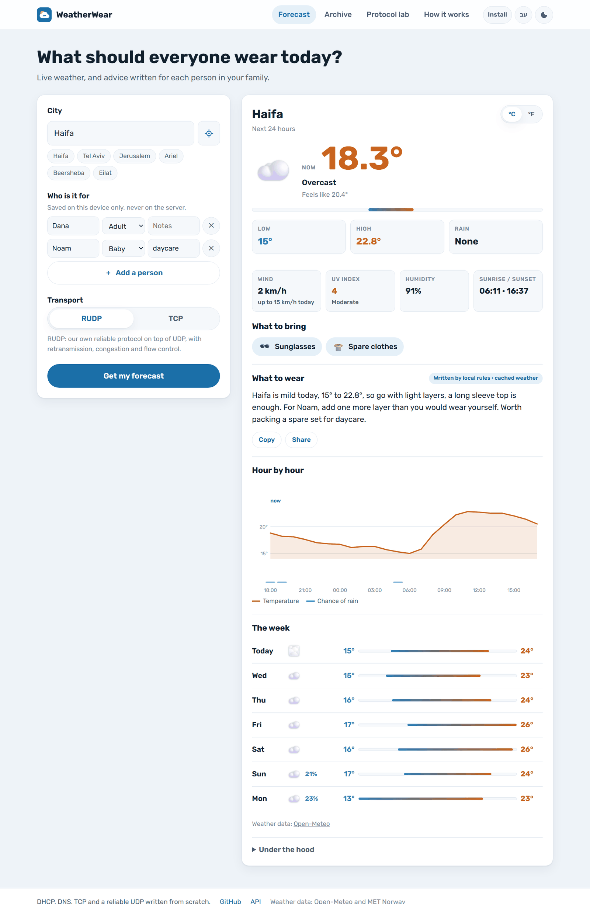
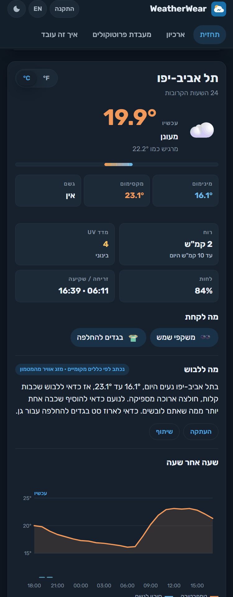
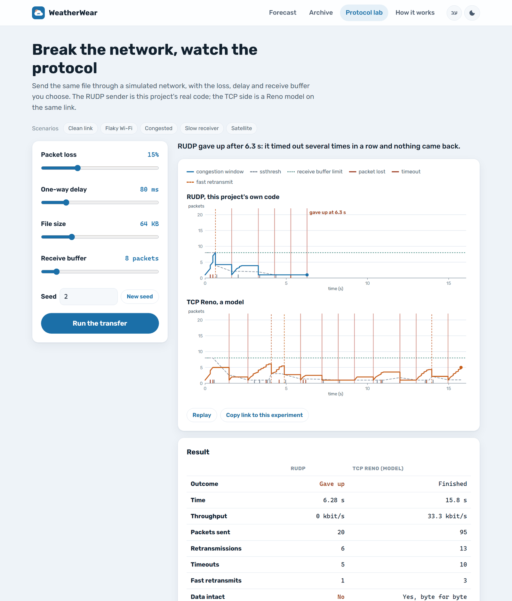
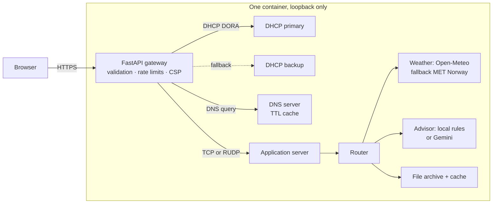
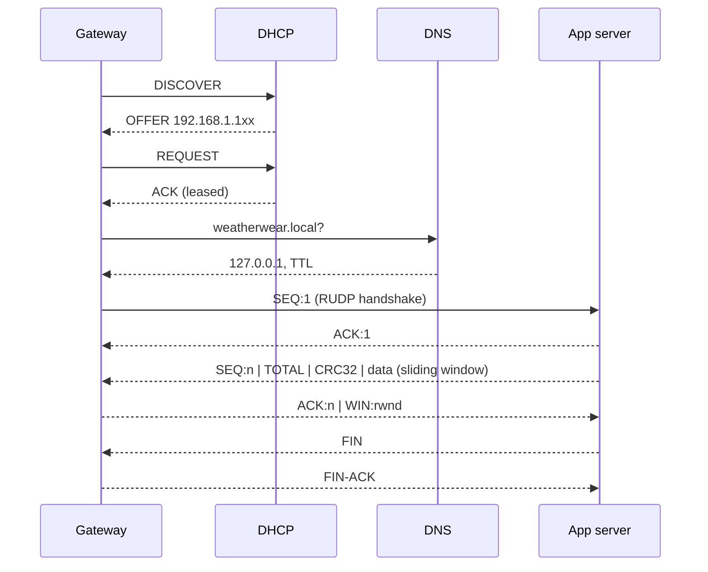

# WeatherWear

[](https://github.com/Matanelevavi/weatherwear/actions/workflows/ci.yml)
[](https://github.com/Matanelevavi/weatherwear/actions/workflows/security.yml)
[](https://github.com/Matanelevavi/weatherwear/actions/workflows/codeql.yml)

**A weather forecast that tells your family what to wear, delivered over a network stack
written from scratch: DHCP, DNS, TCP and a reliable protocol built on top of UDP.**

**Try it: [weatherwear-s7pl.onrender.com](https://weatherwear-s7pl.onrender.com)**
<sub>(free hosting: the first visit after a quiet spell can take up to a minute to wake the server)</sub>

[How it works, in depth](docs/architecture.md) · [Security](SECURITY.md) · [Hebrew / עברית](README.he.md)

<p align="center">
  
  &nbsp;
  
</p>

## What it does

Type a city (in English or Hebrew), describe who is going out (a baby, a child who is
always cold, an adult) and get:

* **the next 24 hours** as a chart, the week ahead, wind, UV, humidity and "feels like";
* **advice written for each person**: a baby gets a different sentence than an adult,
  and it says the hour the rain starts, not just that it might rain;
* **what to bring** as a short list of icons (umbrella, sunscreen, spare clothes...);
* an **Under the hood** panel showing how the answer travelled: which transport, how
  many datagrams, how many were retransmitted, duplicated or failed their checksum.

It works in Hebrew and English (full right-to-left layout), in light and dark, on a phone,
installs as an app and opens offline on the last forecast. A forecast can be shared as a link.

## The protocol lab

<p align="center">
  
</p>

The **Protocol lab** tab sends a file through a simulated network with the loss, delay,
file size and receive buffer you choose, and draws the congestion window as it happens:
slow start, a timeout collapsing the window, a fast retransmit halving it, flow control
capping it. It runs the project's **real RUDP sender and receiver**, unchanged, on a
virtual clock, next to a TCP Reno model on the very same lossy link, so the two can be
compared packet for packet. Every experiment is a shareable link, for example
[15 % loss](https://weatherwear-s7pl.onrender.com/#lab?loss=15&delay=80&size=64&buffer=8&seed=2),
where you can watch RUDP give up after repeated timeouts while Reno keeps going.

## How it works

The website is **one more host on the simulated network**. A browser cannot speak RUDP, and
a UDP port that answers a small request with a large reply must never face the internet,
so only HTTPS is exposed. Behind it, the gateway joins the network like any other client.





## Technical highlights

* **RUDP, written from scratch over UDP**: CRC32 over header and payload, a sliding window,
  slow start and congestion avoidance, fast retransmit on three duplicate ACKs, and flow
  control through an advertised receive window. A zero window is probed, not deadlocked.
* **DHCP with honest pool management**: offers are reserved, not leased, and expire if never
  claimed; leases expire without a RELEASE; a backup server answers late with its own pool,
  and the server that was not chosen frees its reservation at once.
* **One router, two transports**: nothing above the `Transport` interface branches on TCP
  versus RUDP, and the router never learns how a request arrived.
* **Resilient to a throttled provider**: per-endpoint circuit breaking after HTTP 429,
  a second provider (MET Norway) with its different data handled honestly (UTC to local time,
  rain in millimetres rather than an invented percentage, clear-sky UV reduced for cloud),
  and a recent forecast served with a banner when both are unavailable.
* **Privacy by design**: the family description stays on the visitor's device and is never
  stored on the server; a shared location is rounded, cached under a hashed name and never
  listed in the public archive or put in a link.
* **Accessible, dependency-free frontend**: vanilla JavaScript, no build step, an ARIA
  combobox for place search, keyboard-readable charts, and no inline scripts (strict CSP).

## Security

Treated as a first-class feature, not an afterthought. The details, including a threat model
with 25 threats and the mitigation for each, are in [SECURITY.md](SECURITY.md).

* **Fuzzing** every network parser with Hypothesis found three real bugs (one datagram could stop
  the DHCP server; the packet parser accepted non-canonical headers), each now a regression test.
* **In CI on every push**: Bandit, pip-audit, CodeQL and gitleaks over the full history, with
  Dependabot watching dependencies. The container image was scanned with Trivy, which led to
  patching its operating system packages at build time.
* **Hardening**: input validation at the edge, per-visitor rate limits (separate budgets for
  forecasts, search and the lab), request size limits, thread and connection caps, a deadline
  against slow clients, path traversal guards, and CSP, HSTS and related headers.

Found something? Please report it privately through **Security → Report a vulnerability**.

## Quality

* **547 automated tests** (`python -m unittest discover -s tests -t .`), using mocked sockets,
  so nothing touches the network: the DHCP state machine, DNS, RUDP framing, congestion and
  flow control, the providers and their failures, the website's API, limits and headers.
* Interface tests assert that every desktop window fits the screen it opens on.

## Run it yourself

```bash
pip install -r requirements.txt
python -m src.web.serve          # the website, at http://127.0.0.1:8000
python run.py                    # or the desktop client, over the same servers
```

No configuration is needed. `GEMINI_API_KEY` optionally upgrades the advice to AI-written
text; without it the advice is generated locally from the same numbers. To deploy, the repository
ships a `Dockerfile` and a Render blueprint (`render.yaml`).

Watch the protocols misbehave on purpose:

```bash
SIMULATE_LOSS=1 python run.py          # drop packets, watch retransmission
RUDP_RECV_BUFFER=2 python run.py       # a tiny receive buffer throttles the sender
```

## Stack

Python standard library sockets and threads for every protocol · FastAPI and Uvicorn for the
gateway · vanilla HTML, CSS and JavaScript (PWA) · Docker on Render behind Cloudflare ·
GitHub Actions. Weather data from [Open-Meteo](https://open-meteo.com) and
[MET Norway](https://api.met.no) (CC BY 4.0).

## Limitations, honestly

* The rate limit is in memory, per instance; several instances would need a shared store.
* The TCP curve in the lab is a Reno model, since the operating system's TCP cannot be placed on a
  simulated lossy link. The page says so.
* MET Norway gives no sunrise or sunset, so that tile is hidden when it is the source.

More in [SECURITY.md](SECURITY.md#known-limitations).

## Author

**Matanel Levavi** · [GitHub](https://github.com/Matanelevavi)

Released under the [MIT License](LICENSE).
